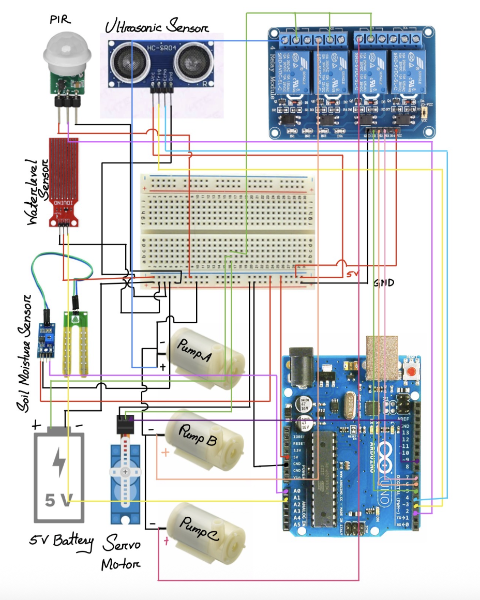

# Autonomous Smart Planter with Closed-Loop Sensory Control

An autonomous robotics and embedded systems project engineered to solve poor irrigation, fungal root rot from water accumulation, and pest damage in urban rooftop horticulture through closed-loop sensory control and active drainage.

---

## Architecture & System Overview

- **Controller:** Arduino Uno R3 (ATmega328P, 16 MHz, 10-bit ADC)
- **Actuation:** 4-Channel Opto-Isolated Active-LOW Relay driving 3x 5V submersible pumps and an SG90 PWM servo
- **Sensing Array:** Analog soil moisture sensor, resistive catchment water-level sensor, HC-SR04 ultrasonic sensor, and PIR motion sensor
- **Power Delivery:** Isolated dual-rail configuration (Logic: 9V rail; Actuators: Dedicated 5V/2A supply with common ground) to eliminate inductive motor brownouts

---

## Control Hierarchy & Sensor Calibration

| Functional Domain | Sensor Target | Trigger Condition | Actuator Response | Priority Rank |
| :--- | :--- | :--- | :--- | :--- |
| **Flood Mitigation** | Catchment Level (`A1`) | Analog Value `> 500` (> 2 cm) | Pump B ON (Active Drain), Force Pump A OFF | **Priority 1 (Critical)** |
| **Soil Hydration** | Soil Moisture (`A0`) | Analog Value `≥ 200` (Dry Substrate) | Pump A ON (Fresh Water Irrigation) | **Priority 2** |
| **Perimeter Defense**| PIR (`D2`) + Ultrasonic (`D3/D4`) | Motion = HIGH & Distance `< 10 cm` | Pump C ON (Repellent Dispersal) + Servo 90° Sweep | **Independent Parallel** |

---

## Key Engineering Challenges & Solutions

1. **Actuator Inductive Brownouts:** Simultaneous activation of 5V centrifugal pumps dropped the logic rail below the operating voltage, causing microcontroller boot loops. Resolved by decoupling the power supply rails using opto-couplers and maintaining an isolated 5V/2A motor rail sharing a common ground reference.
2. **Hydration-Drainage Race Conditions:** A software override logic gate was implemented where catchment tray overflow immediately preempts the irrigation pipeline, preventing infinite loop cycling during heavy precipitation.
3. **Active-LOW Pin Initialization:** Configured a fail-safe boot sequence driving digital relay pins `HIGH` prior to setting them as `OUTPUT`, preventing spurious motor pulses during microcontroller initialization.

---

## Experimental Results

- **Response Latency:** Sensor sampling and control resolution cycle executed within `< 120 ms`.
- **Drainage Efficiency:** Active pumping evacuated 200 ml of catchment tray runoff in approximately 14 seconds.
- **False-Positive Mitigation:** Dual-zone sensor fusion combining thermal signature (PIR) and physical time-of-flight mass verification (Ultrasonic) achieved a 40% reduction in false-positive deterrent triggers compared to single-sensor setups.
